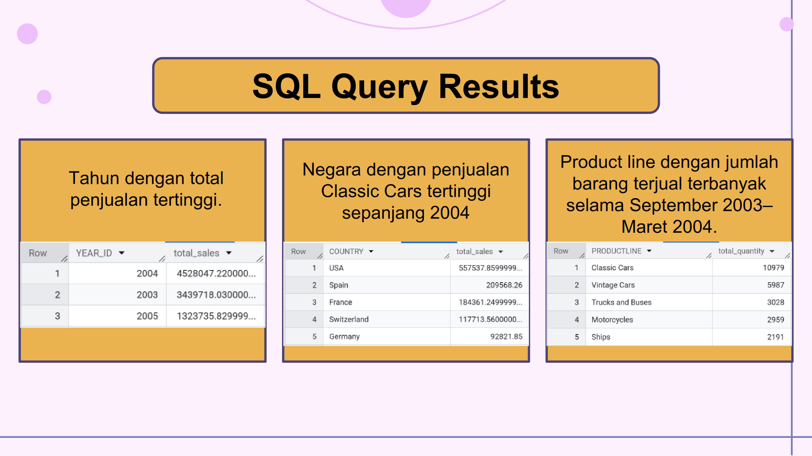
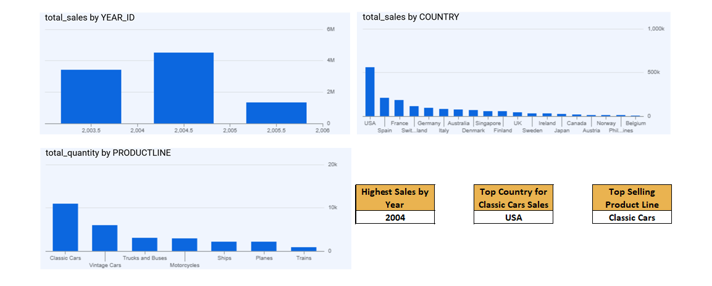

# Analisis-Data-Penjualan-Menggunakan-SQL-dan-Google-BigQuery
Case Study dari RevoU untuk mengidentifikasi pola penjualan pada perusahaan retail menggunakan SQL di Google Cloud BigQuery.

Proyek ini bertujuan untuk melatih kemampuan pengolahan data menggunakan SQL, penerapan filter, agregasi, pengelompokan data, serta penyusunan insight yang relevan dengan kebutuhan bisnis.

#### Tujuan
Proyek ini mencakup tiga pertanyaan bisnis:
1. Identify the total sales for each year. Which year had the highest total sales?
2. Which country had the highest sales of Classic Cars throughout 2004?
3. Which product line was sold the most (in quantity) throughout September 2003 to March 2004?

#### Tools yang Digunakan
1. Google Cloud BigQuery
2. SQL

#### Metode Analisis
Teknik SQL yang digunakan meliputi:
1. *SELECT* untuk memilih kolom yang dianalisis.
2. _WHERE_ untuk memfilter pesanan berstatus Shipped dan menentukan periode analisis.
3. *SUM()* untuk menghitung total nilai penjualan atau jumlah barang.
4. *GROUP BY* untuk mengelompokkan data berdasarkan tahun, negara, atau product line.
5. *ORDER BY* untuk mengurutkan hasil berdasarkan nilai tertinggi.

#### Daftar Query
File Query disimpan dalam bentuk .txt meliputi: 
|File|Analisis|
|---|---|
|Sales_by_Year.txt|Total penjualan per tahun|
|Classic_Cars_by_Country.txt|enjualan Classic Cars per negara pada 2004|
|Product_Line.txt|Jumlah barang terjual per product line selama September 2003–Maret 2004|

#### Hasil dan Insight
Hasil analisis ditampilkan dalam bentuk pptx atau pdf, dengan kesimpulan sebagai berikut:
1. Tahun dengan total penjualan tertinggi adalah tahun 2004.
2. Negara dengan penjualan Classic Cars tertinggi pada 2004 adalah USA.
3. Product line dengan jumlah barang terjual terbanyak adalah Classic Cars.

#### Preview Analisis

